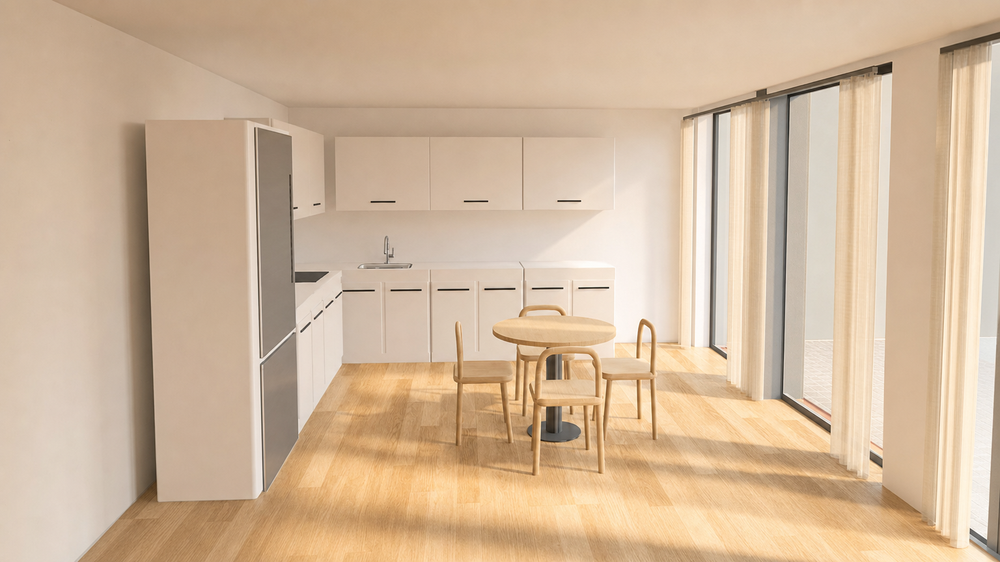
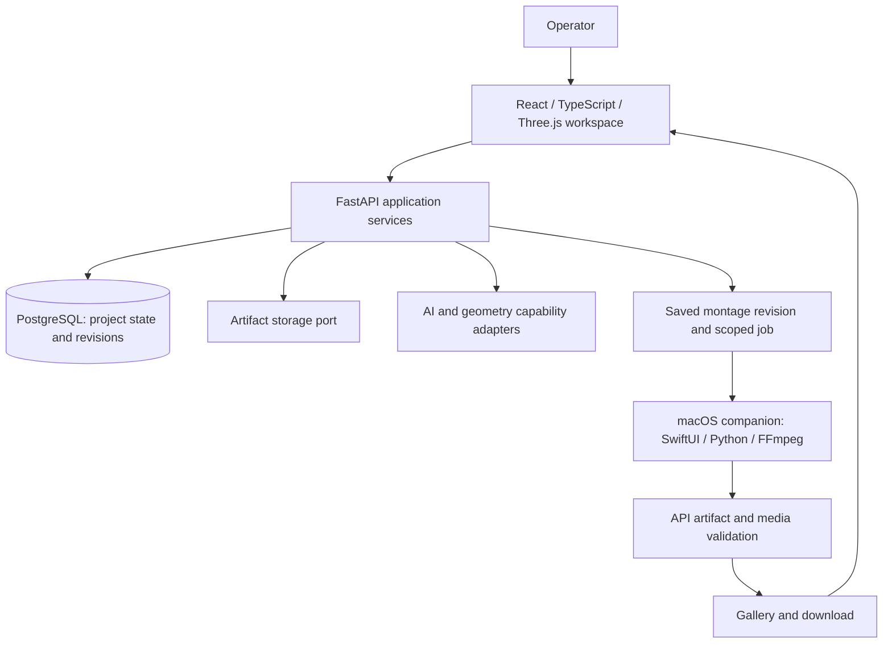

# Cadvert

**Architectural source material → reviewed visual assets → finished property films.**

Cadvert is a product and engineering project by **Rasool Zandian, Product Creator & Technical Lead**. It connects architectural information, CAD-derived geometry, AI-assisted visual workflows and video assembly in one reviewable workspace.

[Explore the public case study](https://cadvert-engineering-showcase.free-grape-4414.chatgpt.site/) · [Watch a sample film](https://cadvert-engineering-showcase.free-grape-4414.chatgpt.site/assets/property-film.mp4) · [Contact Rasool](mailto:rasool.zandian@gmail.com)

This public case study presents selected outputs and architecture. Product source code remains private.

## Why it exists

Architectural presentation often involves moving between drawings, geometry tools, AI providers and video editors. The difficult part is preserving the relationship between source evidence, human decisions and the assets ultimately delivered. Cadvert makes those transitions explicit rather than treating generated media as verified architectural truth.

A representative workflow is:

1. Create a project and attach source material.
2. Review extracted knowledge or CAD-derived interpretations.
3. Prepare and inspect geometry and visual candidates.
4. Select approved assets and assemble a montage.
5. Save a revision, render it and validate the returned artifact before gallery publication.

Supported paths depend on source format, available adapters and the particular workflow. This is not a universal DWG-to-BIM converter.

## See the output

*An actual visual-study artifact. It communicates material and lighting intent; it does not certify geometric or regulatory accuracy.*

| Sample | What it demonstrates |
| --- | --- |
| [CAD-derived model](assets/cad-model.png) | A raw geometry baseline for inspection |
| [Montage workspace](https://cadvert-engineering-showcase.free-grape-4414.chatgpt.site/assets/montage-workspace.jpg) | The recorded product interface used to assemble media |
| [Rendered film](https://cadvert-engineering-showcase.free-grape-4414.chatgpt.site/assets/property-film.mp4) | A 46.42-second preview encode at 960 × 540 / 24 fps |

These are independent project samples, not a matched before-and-after comparison. The public case study explains their provenance and limitations.

## Architecture

The backend is a modular application, with business services separated from provider-specific behavior. The native companion handles selected processing tasks; it is not a second system of record.

- **Reviewable AI:** extracted suggestions and generated candidates remain distinct from approved project knowledge.
- **Persistent workflow state:** PostgreSQL stores important decisions and revisions rather than relying on browser state.
- **Provider boundaries:** capability interfaces separate application orchestration from vendor implementations.
- **Revision-bound rendering:** the Mac montage workflow uses immutable revisions, input hashes, task-scoped credentials and worker leases.
- **Validation before publication:** the server checks returned media against the saved montage contract. Human approval and technical validation serve different purposes.

## Engineering evidence

A recorded local montage benchmark on an **Apple M2 with 8 GiB RAM** produced a 46.42-second **1920 × 1080 / 48 fps** H.264 export in **130.969 seconds**, with **336.59 MiB peak FFmpeg child-process RSS**. This was one run per profile, excluding network downloads; the memory number is not total application or system memory. The downloadable sample above is a separate lightweight preview encode.

The repository defines backend linting, typing and tests; frontend typing, tests and builds; and native worker contract tests. Test definitions are evidence of the verification approach, not a claim that every check passed in this documentation review.

## My role

**Rasool Zandian — Product Creator & Technical Lead**

I defined the product direction, designed the system architecture and led implementation across the web application, AI capabilities, geometry workflows and native processing companion. My responsibilities include turning operational needs into focused delivery slices, establishing review and persistence boundaries, and guiding technical validation.

Development uses AI-assisted engineering. My contribution is product and technical ownership: deciding what to build, evaluating generated changes, reviewing behavior and directing delivery. I do not present contribution counts as a substitute for engineering outcomes.

Cadvert is my product case study. My contract role at Elite Engineering Group is a separate engagement.

## Status and boundaries

The private product contains implemented application workflows; this public portfolio includes selected output artifacts. Deployment configuration and local benchmark results do not establish an audited production SLA, commercial adoption or universal CAD fidelity. Selected outputs may involve external AI services; this is not an entirely on-device processing claim.

Plan Intelligence is an evolving extension. Fixed-output interaction prototypes and model-training plans must not be represented as a validated production ML model. The README does not claim production-trained neural-network performance.

## Technology

Python · FastAPI · Pydantic · SQLAlchemy · PostgreSQL · React · TypeScript · Vite · Three.js · SwiftUI · FFmpeg

## Review this case study

Start with the images above and the [public interactive showcase](https://cadvert-engineering-showcase.free-grape-4414.chatgpt.site/). The showcase includes the film and recorded workspace. This repository contains no runnable product or deployment instructions.

[Sample provenance](../PROVENANCE.md) · [Portfolio overview](../README.md)

## Contact

Interested in Applied AI Engineer and Technical Lead opportunities in the Netherlands and Austria.

**Rasool Zandian** · [LinkedIn](https://www.linkedin.com/in/rasool-zandian-990515163/) · [Email](mailto:rasool.zandian@gmail.com)
