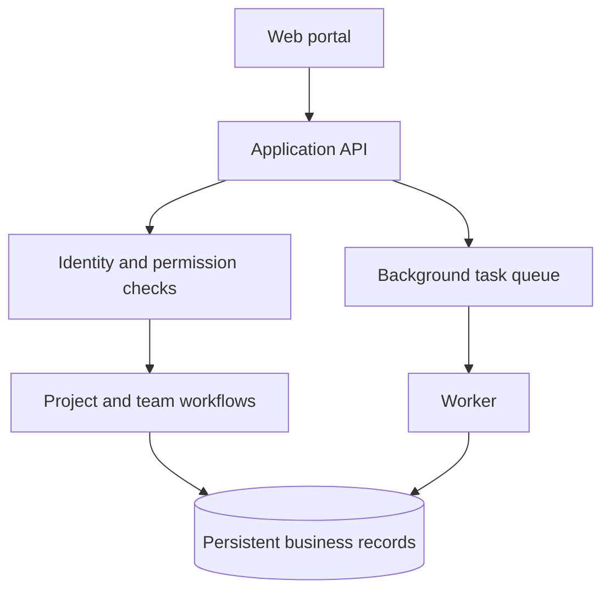

# Elite — Engineering Operations Platform

**Technical leadership for a structured, access-controlled engineering workspace.**

**Rasool Zandian · Technical Supervisor & Technical Lead**
Contract engagement with Elite Engineering Group · September 2026–present

This is a public case study of my role and the platform's high-level engineering approach. It includes no proprietary source code, internal documentation, customer files or employee records.

## The problem

An engineering team needs to connect project registration, ownership, access and resource allocation. Those workflows need consistent records and explicit responsibilities before AI features can be useful or trustworthy.

## Current scope

The reviewed application source includes project registration and details, catalog-based project classification, team access management and resourcing workflows. Persistent state and background processing support these workflows.

**Maturity: development / staging.** Implemented source is not proof of production acceptance. Retrieval-augmented generation, automated engineering rules and LLM-generated reports are future capabilities; no production AI performance is claimed here.

## Architecture overview



| Layer | Technologies | Purpose |
| --- | --- | --- |
| Web | React, TypeScript, Vite | Operator workflows and review |
| Application | Python, FastAPI | Validated requests and business behavior |
| Persistence | PostgreSQL, SQLAlchemy, Alembic | Durable state and versioned schema |
| Background work | Celery, Redis | Asynchronous execution |

This is a conceptual overview, not an internal deployment or security specification.

## Example: a completed background task

[View the synthetic sample](samples/completed-task.json).

```json
{
  "example_type": "synthetic_portfolio_illustration",
  "task": "Demonstration task",
  "status": "completed",
  "result": "Illustrative completion result"
}
```

This invented sample illustrates the API → queue → worker → persisted-result pattern. It is **not an actual API contract, customer record, production execution or generated engineering report**.

A synthetic demonstration can show a fictional project being registered, reopened and reviewed by an authorized test user. A separate test user can demonstrate restricted access. This describes a demonstration scenario, not a published live demo.

## My role and decisions

I supervise technical direction and implementation delivery, translate business requirements into reviewable scopes, and oversee technical review and acceptance.

- **Workflow design:** connect registration, ownership and team coordination around a consistent project model.
- **Architecture:** establish boundaries between the interface, business behavior, persistence and background work.
- **Quality:** make permission checks and workflow behavior testable; review evidence before accepting delivery.
- **Future AI integration:** keep deterministic business rules separate from generated suggestions and require evaluation and review for new AI capabilities.

This is a team engagement. Technical leadership is distinct from claiming authorship of every implementation change.

## Engineering lessons

An AI roadmap benefits from a reliable operational foundation. Structured data, scoped access and clear review steps make it easier to introduce retrieval or assisted decisions later without treating generated text as an authoritative engineering result.

The private project includes backend, frontend and integration test definitions. This case study does not publish internal tests, current CI results or a production-readiness certification.

## Contact

**Rasool Zandian** · [LinkedIn](https://www.linkedin.com/in/rasool-zandian-990515163/) · [Email](mailto:rasool.zandian@gmail.com)

[Portfolio overview](../README.md) · [Cadvert: separate product case study](../cadvert/README.md) · [Publication scope](../PROVENANCE.md)
